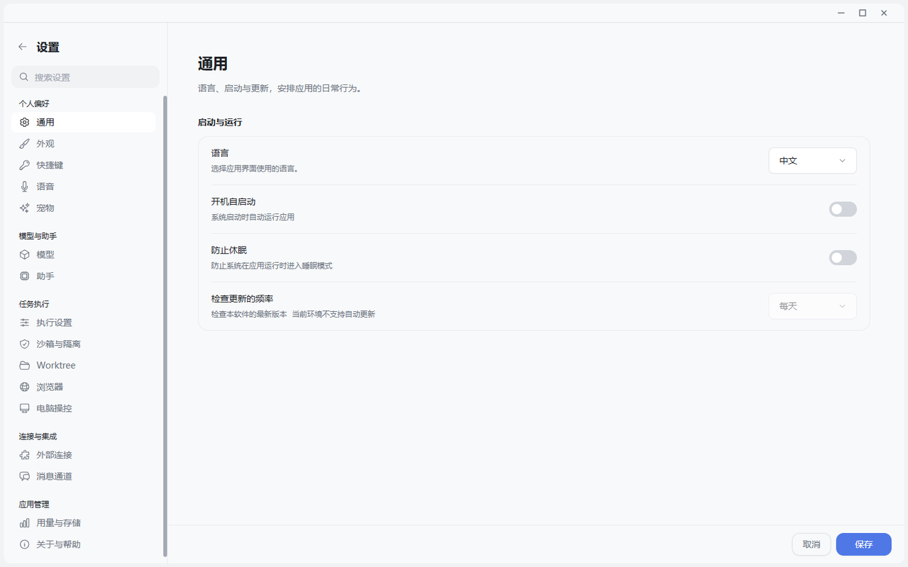

# 从聊天助手到行动工作台

从这张实际运行截图可以一眼看到 JustDo 的产品跨度：个人偏好只是最上层，下面依次是模型与助手、任务执行、沙箱、Worktree、浏览器、电脑操控、外部连接、消息通道以及用量与存储。它更接近一个 Agent 操作系统的控制台，而不是聊天软件的偏好页。

## 核心定位

传统 AI 产品把一次回答当作终点。JustDo 把回答当作工作过程中的一个界面：它可以继续调用工具、打开浏览器、生成文件、等待确认、组织其他助手，并在用户离开后按计划继续执行。

## 一个更有画面的故事

想象你对 JustDo 说：“研究三家竞品最近的产品更新，做一份对比表和汇报稿，发现关键变化就每周一更新。”

这个任务不是一次模型补全，而是一串真实动作：理解目标，访问网页，保留来源，整理表格，生成演示材料，遇到登录或高风险动作时等你确认，把长期目标和一次执行区分开，并在下一次运行时接着上次结果继续。JustDo 的产品价值就在于把这些动作放进同一个可观察、可接管、可恢复的桌面工作现场。

## 五层能力栈

| 层次 | 用户看到什么 | 系统真正负责什么 |
| --- | --- | --- |
| 会话层 | 自然对话、思考过程、工具卡片、排队输入 | 实时流、历史接管、身份去重、断线恢复 |
| 界面层 | 表格、图表、表单、draw.io、文件编辑器 | MCP Apps、原生 widget、沙箱 iframe、上下文桥 |
| 行动层 | 浏览网页、操作 Tab、下载、上传、生成 PDF | Browser Tool、DOM/AX/截图观察、动作 lease、工作区边界 |
| 能力层 | Skills、MCP、Extension、Hook | 发现、启停、审批、受控安装与配置同步 |
| 持续层 | Goal、定时任务、子任务、协作助手 | 原生 session/run、幂等回执、状态恢复、结果收件箱 |

这五层并不是五个彼此独立的功能菜单。它们围绕同一条执行主线工作：Renderer 负责交互投影，Main 负责桌面权限和生命周期，OpenClaw Gateway 负责 Agent 执行、会话、工具与原生历史。公开架构说明将 Gateway 定义为执行与 transcript 权威，而 JustDo 负责产品会话、权限、导航和恢复，参见 [Cowork 架构](https://github.com/liangxhao/JustDo/blob/HEAD/docs/architecture/04-cowork-system.md)。

## 为什么它不是普通聊天壳

第一，聊天正文不在 Redux 或产品数据库里另存一份竞争副本。Gateway 历史是唯一持久事实，界面用身份和代次把实时事件、乐观消息与历史合并。这样做的价值不是“架构优雅”，而是应用重启、切换会话、网络抖动以后，系统仍知道哪一段是真的。

第二，工具不是一排静态按钮。Skill 提供可复用的方法，MCP 接入外部能力，MCP Apps 把工具结果变成可操作界面，Browser Tool 处理没有合适 API 的长尾网页任务。

第三，用户不是只能等结果。JustDo 允许在执行中停止、排队补充信息、接管浏览器、回答结构化问题、批准计划或工具调用。Agent 的自主性和人的控制权同时存在。

## 产品判断

可以把 JustDo 的竞争坐标说得更清楚：

- 它不是只追求“模型更聪明”，而是追求工作闭环更完整。
- 它不是把一切塞进聊天气泡，而是让内容进入最合适的交互载体。
- 它不是假设任务永远一次成功，而是把取消、未知结果、重连和恢复作为一等状态。
- 它不是把本地运行等同于绝对安全，而是继续校验 Renderer、网页、插件、文件和工具边界。

## 当前边界

JustDo 是 local-first，而不是“所有计算都离线”。模型请求是否离开本机取决于用户配置的 provider。Extension 进入 Gateway 的 Node 信任域，也不等同于恶意代码沙箱。更准确的表述是“本地工作现场、用户可控的数据与执行边界”，不能笼统承诺“数据绝不离开设备”。

## 结语

“JustDo 不是把大模型塞进桌面。它做的是另一件事：把一段会话变成一个持续工作的执行现场。你可以和它聊，也可以让它调用工具、打开真实网页、生成可编辑界面、组织多个助手、按时间继续工作。更关键的是，当任务被打断、浏览器要接管、插件要审批、结果还不确定时，它仍然知道谁拥有事实、下一步该由谁决定。这才是从聊天助手到行动工作台的跨越。”
