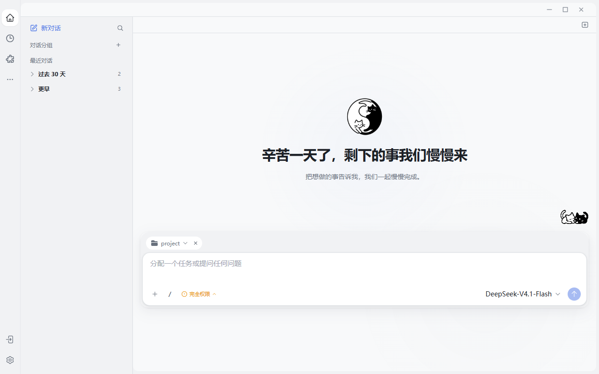
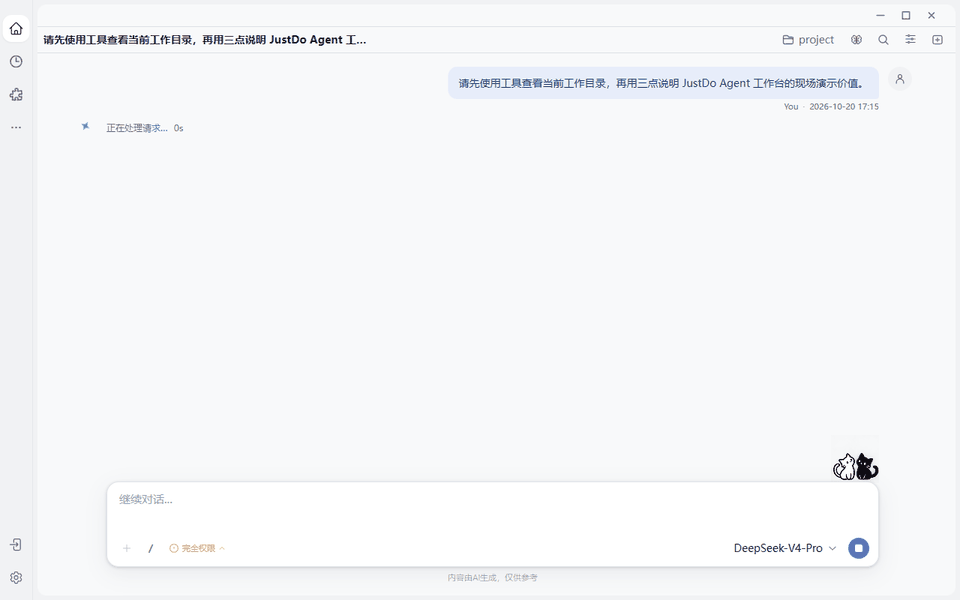

# 流畅会话不是打字机效果

## 用户感受到的流畅

用户发出一句话，消息立刻出现；模型开始思考，工具卡片按真实顺序加入；正文稳定展开，不会忽长忽短；用户上滚阅读时页面不会把人拽回底部；断线回来以后，最终历史可以接管临时画面；任务执行中还可以排队补充下一条输入。

这才是 Agent 会话的“流畅”。逐字动画只是最表面的一层。



实际工作台把会话列表、分组、工作目录、权限、Slash Command 和发送入口放在同一个稳定现场中。流畅会话首先是“上下文没有散掉”，然后才是文字出现得快。

## JustDo 的会话难题

一次 Agent 回合至少同时存在六种事实：产品会话、原生 session、用户提交的幂等 ID、真实 run、实时事件和持久历史。它们到达时间不同，也可能重复、乱序、截断或在切换会话后迟到。

最新版源码把这套问题拆成清晰的所有权：Gateway 历史是持久权威；当前 run 进入单一 reducer；乐观用户消息只在权威历史接管前短暂存在；`sessionKey`、物理 `sessionId`、`runId`、连接 generation、sequence 和稳定消息 ID 一起防止串线。详见 [聊天渲染架构](https://github.com/liangxhao/JustDo/blob/HEAD/docs/architecture/15-chat-rendering.md)。

## 会话交互的四层能力

### 1. 图文渲染：不是“文字旁边挂了个附件”

JustDo 把 Markdown 正文、图片、引用、文件结果和工具返回内容放在同一条时间线上。媒体 URL 会先归一化和去重，再成为消息附件；图片可进入独立预览窗口，预览窗口只加载最小化 preload，不继承主窗口的完整能力。这样既能保持 Blob 图片可见，也不会因为“想放大一张图”就把整个桌面桥暴露给预览页。

这套交互的价值不是支持多少格式，而是让用户始终知道：这张图是谁生成的、属于哪个回合、与哪段文字互相解释。群组讨论同样保留成员身份、引用、Markdown 与媒体附件，导出时也保留正文和附件定位信息。

### 2. Media 可视化：音视频是可操作内容

消息和 Tool 返回的显式媒体共用同一个渲染组件。音频、视频使用原生控件，不自动播放；失败时可以重新加载；消息卸载时停止播放并释放资源，而同一节点在界面内移动时不会把播放进度清零。

本地图片走 `localfile:`，本地音视频走独立的 `localmedia://local/` 流式协议。Main 支持单段字节 Range，能返回 206/416，并按本地 MIME 和指定范围读取，因此长音视频可以拖动进度条，不必先把整个文件吞进内存。CSP 只为本地媒体开放必要来源，没有顺带扩大远程节点或平台权限。

从模型能力看，共享类型已经把输入分为 text、image、audio、video、document；从用户体验看，它们最终仍回到一个可追溯的会话回合，而不是散落到若干临时播放器。

### 3. 会话状态跟踪：不是只有“转圈”和“完成”

一个真实回合会经过排队、准备、启动、等待模型、思考、运行工具、组织回答和重试。JustDo 用明确的运行活动投影呈现这些阶段，并单独识别限流、超时、服务过载、鉴权失败、工具调用格式重试、断线和重连。

状态提示还有时间语义：模型沉默 20 秒后才出现等待提示；确认运行仍活跃时，60 秒进入“较慢但仍在工作”，240 秒进入长等待提醒。正在运行工具、排队或准备上下文不被误判为“模型卡死”。

更重要的是，界面阶段不冒充执行事实：Stop ACK 或一条 chat final 可以收敛按钮和临时画面，却不能单独证明整轮结束。只有匹配当前 run、带 `executionSettled: true` 的 whole-run 终态才结算；断线期间进入“未知”，重连后再向原生运行事实对账。迟到事件可以补充诊断，但不能把已经停止的回合重新激活。

| 用户看到的状态 | 系统实际含义 | 不能据此推断 |
| --- | --- | --- |
| 正在准备 / 排队 | 输入已接收，正在建立上下文或等待执行 | 模型已经开始生成 |
| 思考 / 等待模型 | 当前 run 已进入模型阶段 | 进程一定卡死 |
| 正在运行工具 | 有可观察的外部工作 | 模型无响应 |
| 正在重试 / 限流 | 本次尝试可恢复，系统保留同一运行上下文 | 整个任务失败 |
| 等待你的回答 / 确认 | 执行主动让出决策权 | 会话已经完成 |
| 停止中 / 状态未知 | 正在取消或等待重连对账 | 已经安全终止 |
| 已完成 / 失败 | 精确整轮终态已经核实 | 所有外部副作用都无需再检查 |

### 4. Ask User：把“我需要你决定”做成可恢复协议

Ask User 不是 Agent 在正文里随口问一句，而是结构化的人机接力：每次可提交 1–8 个问题，每题提供 2–4 个选项，支持单选、多选、自由填写“其他”、跳过，以及选中某项后必须补充说明。推荐项被要求放在第一位并明确标记，避免把决策成本重新推给用户。

真正关键的是它有稳定身份和生命周期。Extension 持有 pending、期限、默认值与取消语义；Main 只中继 event/RPC；Renderer 负责展示和提交。每个会话同时只允许一个待答请求，答案必须与原问题精确匹配。断线重连后通过 list/replay 找回原请求，因此“弹窗消失”不等于“用户已经回答”。

等待策略也不是粗暴倒计时：必须由用户决定时无限等待；只有 Agent 能安全兜底时才启用超时。若所有问题都定义了默认项，超时自动选择默认答案；否则把“未收到回答”原样交还模型，由它依据最佳判断继续。取消也会作为显式结果返回同一次工具调用，而不是让执行悬空。

```text
Agent 发现真正属于用户的决策
        ↓ AskUserQuestion(requestId)
桌面展示结构化选项 ── 用户可回答 / 跳过 / 取消
        ↓ 精确 requestId 提交
答案返回原工具调用，Agent 从原上下文继续
        ↘ 断线：list/replay 恢复同一待答请求
```

## 三个底层技术点

### 1. 历史和实时流不是两套 UI

实时 Thinking、Tool、Content 先进入活动回合；Gateway 写入持久消息后，界面按稳定身份完成接管。它不会用“文字看起来一样”或者“时间很接近”来猜测是否重复，因为相同文字可能来自不同工具、不同 run 或不同分支。

这个设计让三个场景变得可靠：切走再回来，应用重启后恢复，以及工具结果比开始事件更早抵达。

### 2. 快，但不牺牲权威文本

JustDo 的显示节奏器把突发到达的大段 snapshot 按动画帧平滑揭示；历史 DOM 使用有界窗口；超长 Markdown 可以降级为安全纯文本，但 canonical 内容不被裁掉。用户看到的是平稳节奏，系统保存的仍是完整事实。

### 3. 运行中输入不再打断当前工作

OpenClaw 原生 followup queue 让用户在任务运行时排队下一条输入。排队内容与正式 transcript 分开投影，消费后才进入历史；Goal 模式、等待问答和侧聊等场景仍有明确门禁。源码文档明确说明队列由 Gateway 排序和持久化，JustDo 不再创建第二套消息队列数据库。

## 如何验证一条完整会话链路

下面这段 16 秒实机动图记录了完整过程：用户提交任务后，标题与运行态先出现，随后 Agent 调用目录工具、增量组织正文，最后把活动回合收敛为可回看的历史。它不是“逐字动画”，而是一条能看见状态、工具与最终答案的完整执行链。



让 Agent 执行一个会读取图片、生成图表并调用两到三个工具的任务，然后连续做六件事：

1. 在输出时向上滚动，证明阅读位置不会被抢走。
2. 打开消息中的图片预览，再播放一段音频或视频并拖动进度条。
3. 展开一个工具卡片，查看输入和结果，但保持主时间线整洁。
4. 让 Agent 遇到一个真实偏好选择，展示单选、多选或“其他”的 Ask User 窗口。
5. 在运行中排队一句“最后再给一个管理层摘要”。
6. 切到另一会话再返回，观察活动状态、待答问题和历史重新对账。

讲解时不要只说“支持多模态”，而要指出四个可验证细节：媒体有没有归属到正确回合，长媒体能不能 seek，状态是否解释当前在等什么，断线后问题是否仍是同一个问题。

## 与行业趋势的关系

2026 年的 Agent 产品越来越强调事件流、可恢复 session 和人机协作，而不是单次请求响应。OpenAI 的 Computer Use 文档也把 session events、活动 item、登录接管和断线恢复作为核心集成流程，而不只返回最终答案。参见 [OpenAI Computer use](https://developers.openai.com/api/docs/guides/agents-api/tools/computer-use)。

JustDo 的优势是已经把这类思想落实到桌面会话的细节中：身份、取消、历史接管、工具生命周期、滚动和性能预算都被当成产品行为。

## 当前边界

流畅不等于永远无等待。首次加载冷归档、超大历史、原生视图恢复或 Gateway 冷启动仍可能耗时。正确体验是明确显示“正在恢复”和可重试状态，而不是用一份可能过期的本地消息缓存假装立即成功。

## 结语

“Agent 会话最难的不是让字动起来，而是让文字、图片、音视频、工具过程和人的决定都留在同一个可恢复现场。JustDo 让媒体可看、可播、可追溯；把排队、思考、工具、重试和断线说清楚；在真正需要人决策时，用有身份、可回放的 Ask User 暂停并继续。它再用 Gateway 历史做唯一真相，用 run、session 和连接代次防止串线。流畅来自对不确定性的管理，不来自一个漂亮的 loading 动画。”
