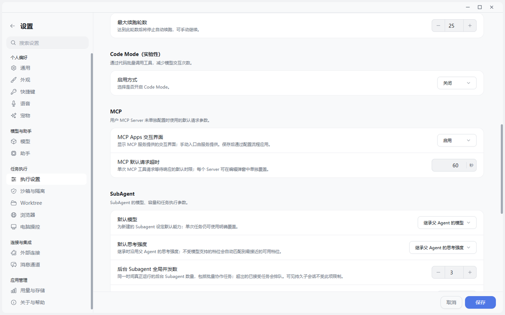

# AI for UI 让答案变成可操作界面

> 一段文字只能被阅读；一个好界面，可以让人立刻比较、选择、修改并继续行动。

## 从答案到界面

当用户问“哪套方案最适合我”，十段文字不是答案，只是新的阅读任务。AI for UI 让答案从聊天气泡里走出来：表格负责搜索和排序，图表让趋势一眼浮现，表单主动收集约束，流程卡逐步展开，画布允许直接编辑。用户不再被迫读完一切，才能开始下一步。

JustDo 最新源码已经形成两条互补路径：

- MCP Apps：MCP 工具返回标准 `ui://` 资源，通过 AppBridge 在会话或工作区中运行。
- 交互式回答：OpenClaw 原生 `show_widget` 展示本地交互卡片或模型生成的安全 HTML。

两条路径不会混在一起。MCP Apps 面向可复用的工具型应用；交互式回答面向一次对话中的动态解释与决策。

这张实机截图展示了 MCP Apps 的产品级开关：交互界面不是某段回答临时拼出来的特效，而是可以被宿主统一管理、设置超时并与 SubAgent 执行参数并列治理的能力。

这段实机动图把 AI for UI 放回完整产品链路：浏览器负责取得现场信息，执行设置负责约束行为，MCP Apps 承载可交互界面，插件中心负责持续扩展能力。它不是一个孤立的“生成网页”按钮。

## 用户看到什么

### 会话里的应用

模型调用工具后，编辑器或仪表盘直接出现在对应工具结果之后。用户可以在原位置展开，不需要跳到另一个网站。内置 draw.io 默认启用，用户也可以从输入框“+”菜单打开空白画布，不必先发一条模型请求。当前实现和生命周期见 [MCP Apps 桌面宿主](https://github.com/liangxhao/JustDo/blob/HEAD/docs/features/chat/mcp-apps.md)。

### 可交互的答案

可选 Interactive UI 扩展提供 table、compare、chart、form、steps，以及固定的 scenario explorer。用户选择、排序或填写之后，组件先生成一段可读建议，只有用户点击“加入草稿”后才进入输入框，最终发送仍由用户决定。详见 [交互式回答](https://github.com/liangxhao/JustDo/blob/HEAD/docs/features/chat/interactive-answers.md)。

## 八个可以直接复用的 AI for UI 示例

### 示例一：供应商选型，从十页文字变成一张决策台

**可以直接输入：**

> 比较 A、B、C 三家客服系统。按年成本、部署周期、私有化、中文支持、API 完整度和迁移风险展示；先给证据表，再做方案对比，最后让我调整团队人数和预算上限。

Agent 可以先用 `table` 展示来源、价格和证据完整度，再用 `compare` 将三家放在同一指标轴上，最后用 `form` 收集团队人数、预算上限和必须私有化等约束。用户搜索证据、切换候选方案、修改预算后点击“继续分析”，界面生成一段可读选择摘要；用户确认加入草稿并发送，Agent 才依据这些真实选择给出推荐。

**关键价值：** 推荐不是写死在卡片里的。界面负责把选择表达清楚，最终推理仍回到 Agent。

### 示例二：经营数据诊断，让图表与明细互相解释

**可以直接输入：**

> 把这份季度数据按收入、毛利率、获客成本和续费率做成可切换图表，同时保留原始数据表；异常月份要能回到对应明细。

`chart` 可以展示折线或柱状图，用户按系列开关收入、毛利率和获客成本；同源 `table` 保留零值、负值和原始行。用户看到毛利率突然下降时，不需要追问“第三季度原始数字是多少”，而是直接展开明细，再让 Agent 解释异常。

**关键价值：** 图不是答案的装饰，而是进入证据的索引。

### 示例三：项目排期沙盘，边调参数边看结果

**可以直接输入：**

> 用交互界面估算这个项目：团队 3–12 人、每天专注 4–7 小时、工作量 280 人时、每人日费 1800 元。让我调整参数，再解释周期和成本如何变化。

固定 `scenario-explorer` 会把团队人数、专注时间、交付周期和成本放到同一张测算卡中。用户拖动参数后可立即看到基于示例公式的变化，再把当前组合送回 Agent，请它补充依赖、假期、并行上限和风险缓冲。

**关键价值：** 页面中的结果是透明假设下的情景测算，不冒充正式项目承诺。

### 示例四：事故处置手册，按步骤展开而不是倾倒长文

**可以直接输入：**

> 把“API 延迟突然升高”的排障过程做成交互式步骤。先判断影响范围，再检查上游、数据库、缓存和限流；每一步说明观察信号和下一步分支。

`steps` 让用户一次展开一个阶段，既保留整体路径，又避免十几条命令和判断条件同时铺满屏幕。需要实际执行时，Agent 仍通过受控工具完成检查；步骤卡只负责解释顺序、证据和分支。

**关键价值：** 交互 UI 可以降低认知负担，但不会绕过工具权限。

### 示例五：发布评审，把“是否上线”拆成可检查条件

**可以直接输入：**

> 为本次发布生成评审台：列出测试、迁移、监控、回滚和负责人；允许按状态筛选，并让我补充计划发布时间、灰度比例和不可接受的风险。

`table` 用于搜索、排序和查看完整行；`form` 收集发布时间、灰度比例和风险阈值；`compare` 可以并列“立即发布、灰度发布、延期”三种策略。用户选择灰度发布后，Agent 根据选择生成具体发布清单，而不是再重复一遍所有候选方案。

### 示例六：招聘与简历评审，先定标准再看排名

**可以直接输入：**

> 按后端工程师岗位评审这些简历。先让我设置 Go、分布式系统、英语和带队经验的权重，再展示候选人证据表和排序；缺少证据必须标记未知。

`form` 让评审者调整权重，`table` 保存候选人逐项证据，`chart` 展示评分分布。Agent 可以指出“未知”与“低分”的区别，并在用户确认权重后重新总结。对于招聘这类高影响场景，界面只辅助组织证据，不能替代人的最终决定。

### 示例七：旅行或活动方案，偏好通过界面逐步收敛

**可以直接输入：**

> 设计三套上海两日团队活动：轻松、美食、户外。用方案对比展示预算、步行量、室内比例和天气风险，再让我填写人数、饮食禁忌和最晚结束时间。

`compare` 适合在同一组指标下选择路线，`form` 收集人数和硬约束，`steps` 展示每天的节奏。用户可以先选择“美食”方案，再补充素食人数；Agent 收到的是结构化、可读的真实偏好，而不是从多轮闲聊里猜。

### 示例八：架构讨论，从选择卡继续到可编辑画布

**可以直接输入：**

> 比较事件驱动、定时批处理和同步调用三种集成方案。选定后，把推荐方案在 draw.io 中画成包含失败重试、人工审批和审计日志的流程图。

第一阶段用 `compare` 帮用户选结构；第二阶段通过 MCP App 打开 draw.io，把结论变成可继续编辑的工作对象。这里最能体现两条路径的配合：交互式回答用于一次决策，MCP App 用于持续创作和交付。

## 交互式问答：不是让 Agent 多问，而是只问真正属于人的决定

AI for UI 解决“怎样看、怎样选”；Ask User 解决“任务执行到这里，哪项决定必须由人来做”。当前实现支持一次提交 1–8 个问题，每题 2–4 个选项，可单选、多选、填写“其他”、跳过，并可要求某个选项附带补充输入。推荐项应放在第一位并明确标记。

下面这些问法可以直接用来复现不同交互形态。

### 问答一：报告面向谁

**触发任务：**“分析这份技术方案并生成汇报稿。”

**Agent 弹出：**“这份汇报主要面向谁？”

- 管理层（推荐）：强调决策、成本和风险。
- 技术评审：强调架构、接口和验证证据。
- 客户沟通：强调场景、价值和可视化效果。

用户选“管理层”后，Agent 从原任务继续，自动改变摘要长度、术语密度和页面结构，不需要用户重新描述整个上下文。

### 问答二：多选交付物

**触发任务：**“整理本次调研，输出需要交付的材料。”

**Agent 弹出：**“本次需要哪些交付物？可多选。”

- 管理层摘要（推荐）
- 对比表
- PPTX
- 可编辑流程图

用户同时勾选摘要、PPTX 和流程图。一个回答就能改变后续三个产物分支，比 Agent 连续追问三次更流畅。

### 问答三：选择后必须补充细节

**触发任务：**“把服务部署到目标环境。”

**Agent 弹出：**“目标环境是什么？”

- 测试环境（推荐）
- 预发布环境
- 指定集群——选择后必须填写集群名称

如果用户选“指定集群”，同一选项内立即出现必填输入。Agent 不需要下一轮再问“具体是哪一个集群”，也不会在缺少名称时贸然执行。

### 问答四：自由填写“其他”

**触发任务：**“为产品首页确定视觉方向。”

**Agent 弹出：**“更偏向哪种视觉风格？”

- 克制的专业感（推荐）
- 高对比科技感
- 温暖生活方式
- 其他：用户填写“像编辑部杂志，但不要复古字体”

“其他”不是把结构化问题退化为聊天，而是给既定选项之外的真实偏好留出口。

### 问答五：可安全超时的日常偏好

**触发任务：**“每天早上整理行业新闻。”

**Agent 弹出：**“默认摘要长度？”

- 5 条精简版（推荐，默认）
- 10 条标准版
- 20 条详细版

这是可以安全兜底的偏好问题，因此可启用超时并配置默认项。用户没有及时回答时，系统明确记录“使用默认选择”，任务仍能继续。

### 问答六：必须等待、不能替用户决定

**触发任务：**“发现目标目录已有同名文件，请继续生成。”

**Agent 弹出：**“如何处理已有文件？”

- 生成新版本并保留原文件（推荐）
- 覆盖原文件
- 取消本次生成

这里涉及用户数据，不能用超时替用户选择覆盖。任务应保持“等待你的回答”，即使断线重连也恢复同一个问题。

## 一个完整的交互式任务链

可以用下面这句话一次串起表格、比较、表单、Ask User 和 MCP App：

> 调研三种客服系统，先用表格列出来源与事实，再用方案对比让我选择。预算和团队人数用表单收集；如果部署方式会影响结论，请用结构化问题问我。确认方案后，把实施流程在 draw.io 里画出来，最后生成一页管理层摘要。

这条任务链依次包含五个动作：

1. 在证据表中搜索并排序，而不是让 Agent 重复朗读数据。
2. 在方案卡中切换选择，观察当前状态仍保留在卡片内。
3. 修改表单并触发校验，证明错误字段不会被悄悄提交。
4. 回答 Ask User，观察 Agent 从原运行上下文继续。
5. 点击“继续分析”后先审阅建议，再加入草稿并手动发送；最后进入 draw.io 继续编辑。

这一串交互能清楚地区分三件事：界面内操作、用户正式提交、Agent 实际执行。三者相连，但不是同一个动作。

### 文件就是工作界面

已安装的 MCP App 可以声明文件入口。用户点击工作区文件时，JustDo 为当前上下文准备受限原生会话，在侧栏打开真正的编辑或预览界面；Renderer 不直接读取文件字节，具体格式、容量和保存语义由插件负责。

## 为什么这是 Agent 的关键能力

界面解决了纯对话的三类摩擦：

1. 信息密度：几十行数据不必被压缩成几段总结。
2. 人类决策：用户可以看、选、调、比较，再把选择交回 Agent。
3. 可持续工作：一个图、一张表或一个文件不是聊天里的终态图片，而是可继续操作的工作对象。

MCP Apps 在 2026 年 1 月成为首个官方 MCP 扩展，目标就是让工具返回沙箱化的交互界面，并在多个兼容宿主之间复用。官方定义和场景见 [MCP Apps 发布说明](https://blog.modelcontextprotocol.io/posts/2026-01-26-mcp-apps/) 与 [MCP Apps 规范站点](https://apps.extensions.modelcontextprotocol.io/)。JustDo 已经从“行业方向”进入“桌面宿主实现”。

## 与 ChatGPT AI for UI 的行业对照

截至 2026-10-20，ChatGPT 的插件 UI 与 JustDo 已经拥有一个重要共同底座：开放的 MCP Apps 标准。MCP Server 可以把工具结果关联到 `ui://` 资源，组件在 iframe 中运行，通过 MCP Apps Bridge 接收工具输入与结果、调用受控工具或发送后续消息。OpenAI 官方明确建议：只有当用户需要检查、比较、编辑、确认或浏览结构化信息时才增加 UI，而且工具在没有组件时仍应可以工作。参见 [OpenAI：为 MCP Server 添加 UI](https://developers.openai.com/plugins/build/chatgpt-ui) 与 [插件架构](https://developers.openai.com/plugins/concepts/plugins)。

| 对比维度 | JustDo | ChatGPT 插件 UI |
| --- | --- | --- |
| 开放标准 | MCP Apps `ui://` 资源与 AppBridge | 同样优先采用 MCP Apps 标准和 `ui/*` Bridge |
| 本地动态回答 | 原生 `show_widget` 加可选 Interactive UI，支持 table、compare、chart、form、steps | 主要由 MCP Server 返回可选 UI 资源，也可通过 ChatGPT 扩展能力增强 |
| 展示形态 | 会话内卡片、桌面工作区、文件入口与 draw.io 等 MCP App | inline card、carousel、fullscreen 等展示模式 |
| 宿主增强 | 桌面文件入口、Gateway 认证文档、本地静态宿主与双层 iframe | `window.openai` 可选扩展支持模态框、文件、结账和 widget state 等 ChatGPT 能力 |
| 组件基础 | 固定交互组件与宿主主题同步，原生 HTML 可按需生成 | 可选 `@openai/apps-sdk-ui` 提供与 ChatGPT 风格一致的按钮、卡片和输入控件 |
| 用户提交 | “继续分析”先生成可读建议，再“加入草稿”，最终由用户发送 | MCP Apps 可通过 `ui/message` 发送后续消息；ChatGPT 扩展也提供兼容桥能力 |
| 无 UI 回退 | 简单问题继续使用正文；插件关闭时不应伪造组件 | 官方要求工具在不渲染组件的客户端也保持可用 |
| 状态与安全 | 真实 Tool 结果准入，绑定 session、连接代际和 docId；外层独立 origin、内层 opaque sandbox | iframe + MCP Apps Bridge；结构化结果按不可信输入处理，能力应通过 feature detection 使用 |

这张表不能被讲成“两个产品已经完全等价”。ChatGPT 的优势是更丰富的通用展示模式、现成组件库和一组宿主扩展；JustDo 的差异点是同一桌面里并存 MCP Apps 与原生 `show_widget`，并把文件工作区、本地工具、会话身份和草稿确认链结合起来。

## 对 JustDo 的产品启发

### 1. 从固定组件继续扩展展示层级

JustDo 当前的表格、对比、图表、表单和步骤适合会话内决策；可以借鉴 ChatGPT 的“从 inline 开始，需要时才扩大到 carousel 或 fullscreen”的原则，为地图、复杂画布和大型数据浏览提供更明确的尺寸升级路径。

### 2. 建立可复用的桌面组件库

OpenAI 提供可选的 Apps SDK UI 组件库，使第三方界面更容易匹配宿主。JustDo 可以把现有主题 token、控件层级、焦点、错误提示和无障碍要求沉淀为公开组件层，减少不同插件各自重做表单和按钮。

### 3. 坚持能力探测，而不是判断宿主名字

OpenAI 官方建议插件检测具体扩展能力，并在缺失时回退，而不是写死“如果运行在 ChatGPT”。JustDo 的 MCP App 同样适合通过能力协商判断文件入口、工作区、模态展示或草稿桥是否存在，以保持跨宿主可移植性。

### 4. 保留 headless 工具路径

UI 是更好的交互方式，不应成为工具唯一能工作的方式。MCP 工具应先返回模型可理解的结构化结果，再在需要时渲染界面；后台 Goal、定时任务和无 Renderer 的运行才能继续完成工作。

## 安全并不是把 HTML 塞进气泡

最新版实现强调四个边界：

- 只有真实原生工具结果或认证启动入口能准入 App，助手自己拼出的 JSON、短码或 HTML 不授予权限。
- App 运行在专属 sandbox listener 和双层 iframe 中，宿主校验 window、origin、文档和消息 schema。
- 业务工具、资源、审批和问题仍由 Gateway 拥有，Renderer 不获得 token 或任意 Gateway 调用权。
- “加入草稿”与“发送”是两个动作，组件不能代表用户直接发消息。

## 当前边界

关闭一个 App 的 DOM 不等于取消已经发出的工具操作。OpenClaw 2026.10.4 当前没有公开的精确请求取消和显式视图释放接口，部分租约最长约十分钟。因此可以确认的是“受控展示和精确准入”，不能把它表述为“关掉界面就撤销一切后台副作用”。

## 完整使用场景

让 Agent 生成一张项目方案对比：先用 compare 选择方案，再用 form 修改团队人数和预算，点击“加入草稿”，让 Agent 根据用户真实选择继续分析。随后打开 draw.io，把结论转成流程图。用户可以直观看到：对话没有消失，但它不再是唯一界面。

## 结语

“AI for UI 不是让模型随便画一个网页，而是让 Agent 在需要比较、选择、编辑和确认时，给人一个更合适的操作界面。JustDo 同时支持标准 MCP Apps 和原生交互式回答：前者把可复用应用带进会话，后者把一次答案变成表格、图表或表单。工具仍由 Gateway 管，界面仍在沙箱里，人仍然掌握最后一次发送和确认。”
