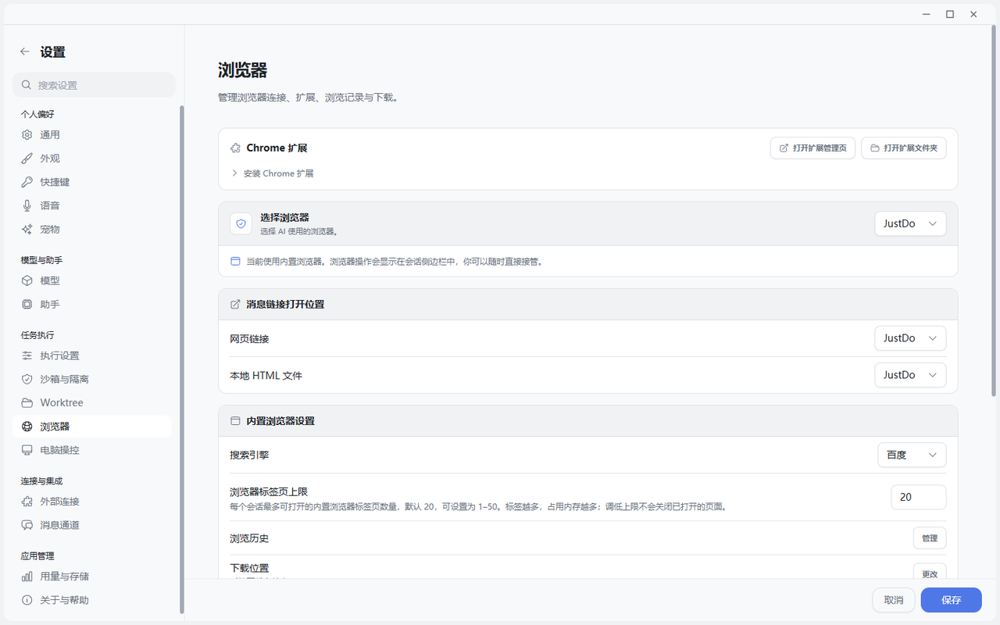
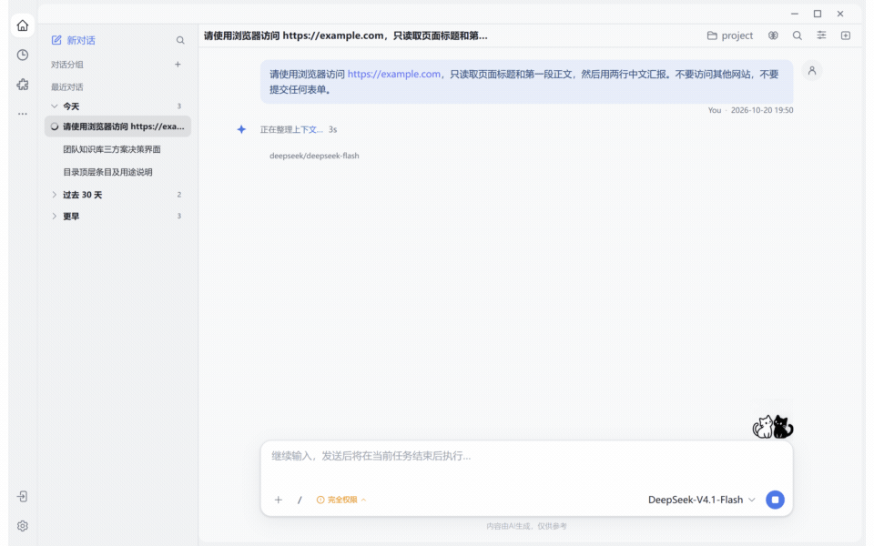

# 浏览器从工具升级为共同工作现场

> 当网页在你眼前打开，Agent 的行动就不再发生在黑箱里。

## 最直观的产品画面

用户说一句“去查清楚”，右侧真实网页随即亮起。Agent 打开页面、读懂结构、追踪来源、点击按钮；你不必猜它去了哪里，也不用等到最后才发现走错了路。遇到验证码、登录或关键页面，人随时接管；任务完成后，来源和产物重新汇入会话。

这比“后台跑一个不可见脚本”更像共同工作。



截图中可以直接看到浏览器选择、消息链接归属、标签页上限、历史、下载位置与代理策略。它们共同说明：浏览器不是一次性工具调用，而是一套有资源预算、数据归属和用户接管入口的工作环境。

## 实操：让 Agent 只读一个指定网页

```text
请使用浏览器访问 https://example.com，只读取页面标题和第一段正文，
然后用两行中文汇报。不要访问其他网站，不要提交任何表单。
```



**实测结果：** JustDo 打开了 `example.com`，用浏览器工具读取 `h1` 和第一段正文，最终返回标题 “Example Domain”、原文内容以及来源卡片。运行中可以看到 Browser 工具调用；完成后来源仍留在摘要面板。这是一个很小的任务，却同时验证了网址约束、结构化读取、来源保留和不提交表单四件事。

## 四种模式对应四种信任关系

最新版公开源码已经从早期三种模式发展为四种：

| 模式 | 最适合的场景 | 核心特点 |
| --- | --- | --- |
| 内置浏览器 | 日常 Agent 工作 | 用户与 Agent 共用 JustDo 侧栏中的真实网页 |
| 隔离浏览器 | 需要独立资料和 Cookie | OpenClaw 管理独立浏览器环境 |
| 用户浏览器 | 使用日常 Chrome 环境 | existing-session driver 连接用户 Chrome |
| 浏览器扩展 | 只授权已登录的特定 Tab | extension driver 与 Tab Access 控制 |

新用户默认使用内置浏览器；原生 Browser 与 embedded-browser 互斥，任何时刻只有一个名为 `browser` 的 Tool，避免模型看到两套含义冲突的动作。详见 [浏览器四种模式](https://github.com/liangxhao/JustDo/blob/HEAD/docs/features/browser/browser-settings-design.md)。

## Agent 如何“看”网页

内置浏览器不是只截一张图。它可以返回 DOM、可访问性树、截图和页面文本；同源 iframe 与 open Shadow DOM 可以递归观察，可获取的跨域 AX 语义也能合并。DOM `eN` 引用绑定快照和文档，导航或大规模变化后失效，避免模型拿旧引用误点新页面。

这与 2026 年主流浏览器 Agent 的高效路径一致：先拿紧凑的 accessibility snapshot 和 element refs，再执行 click/fill，页面变化后重新 snapshot。Vercel 的 agent-browser 也将 snapshot + refs 作为核心工作流，并用稳定引用减少模型上下文消耗，参见 [agent-browser Snapshot and Refs](https://github.com/vercel-labs/open-agents/blob/main/.agents/skills/agent-browser/references/snapshot-refs.md)。

## 人与 Agent 如何不互相抢方向盘

JustDo 为同一网页引入控制权 lease：Agent 操作时 Renderer 覆盖交互遮罩；用户进行画笔、框选、元素检查、评论或录制时，反向阻止 Agent 导航、输入、切 Tab 和关闭页面。观察动作仍可继续，因为“看”不应破坏现场。

这种设计比简单的“暂停按钮”更重要。它明确回答了一个产品问题：同一块真实界面在同一时刻由谁控制。

## 浏览器不只是点击器

当前实现还覆盖：

- 每会话 1–50 个 Tab 的资源上限，默认 20。
- 页面来源投影，不额外读取全局浏览历史。
- 工作区内安全上传、下载与 PDF 产物，拒绝覆盖并防止并发路径冲突。
- HTTP 认证、摄像头、麦克风、定位和通知的来源绑定与失效。
- Chromium 资料导入、历史与下载记录清理。
- Chrome 扩展自动配对与手动配对，两者都不把 Gateway token 暴露给桌面 Renderer。

## 与 ChatGPT Browser 的行业坐标

截至 2026-10-20，ChatGPT 官方同样把网页能力拆成不同信任现场：桌面内置 Browser 使用独立浏览器资料；浏览器扩展用于现有 Chrome、Edge、Brave、Opera 或 Vivaldi 标签页和已登录会话；ChatGPT Work 还可以在云端独立电脑中运行浏览器任务。内置 Browser 可以与会话并排显示页面、执行点击与输入、检查渲染结果并留下页面评论。参见 [ChatGPT Browser 官方说明](https://learn.chatgpt.com/docs/browser) 与 [浏览器扩展](https://learn.chatgpt.com/docs/chrome-extension)。

| 对比维度 | JustDo Browser | ChatGPT Browser |
| --- | --- | --- |
| 内置浏览器 | Electron guest，用户与 Agent 共享右侧真实网页 | 桌面内置 Browser，聊天与页面可分屏或全屏 |
| 日常浏览器 | existing-session driver 连接用户 Chrome | 扩展连接 Chrome、Edge、Brave、Opera、Vivaldi 的现有标签页 |
| 隔离环境 | OpenClaw 管理的独立浏览器 profile | 内置 Browser 独立于日常浏览器；Work 还提供云端浏览器 |
| 页面观察 | DOM、AX、截图、页面文本与有生命周期的元素引用 | 可读取页面渲染状态、截图并执行视觉操作；开发模式可在明确批准后使用 CDP |
| 人机协作 | 页面 lease 管理 Agent、标注、录制和用户接管之间的控制权 | 共享页面、浏览器评论、敏感动作确认与人工接管 |
| 权限范围 | 浏览器模式、来源、guest、profile、下载路径和页面来源共同约束 | 浏览、下载、上传可设默认策略与站点例外；管理员可限制来源和开发访问 |
| 页面原生工具 | 通过 MCP、扩展和 Browser Tool 组合 | 支持网站通过 Site tools/WebMCP 暴露结构化动作，视发布与策略而定 |

两者共同说明浏览器 Agent 正从“自动点击网页”走向三个层次：能看见的共享工作区、优先使用的页面结构或站点工具，以及需要明确授权的视觉兜底。JustDo 的差异化重点在于四模式统一到唯一 `browser` Tool、对真实 Electron guest 的所有权校验，以及标注/录制与 Agent 动作之间的 lease。

## 与电脑操控的边界

浏览器能力只处理网页和浏览器承载的本地内容。操作原生桌面软件、系统窗口或跨应用工作流属于独立的 `computer` Tool，必须另行显式启用。详见 [电脑操控让 Agent 跨越应用边界](05-电脑操控让Agent跨越应用边界.md)。

## 当前边界

内置浏览器当前由 Electron webview guest 承载，WebContentsView 仍只是迁移候选，不能把它写成已经完成的 WebContentsView 架构。浏览器自动化也不能保证所有站点都稳定通过：页面可能主动反自动化，AX 树可能缺失，登录和验证码仍可能需要用户参与。

## 结语

“JustDo 的浏览器不是藏在后台的爬虫，而是人和 Agent 共享的网页工作现场。它有四种模式，既能在隔离环境里工作，也能在用户授权的 Chrome Tab 中行动；既能用 DOM 和可访问性引用高效操作，也能在需要时看截图。更关键的是，系统明确管理谁在控制页面，什么时候要用户接管，文件和下载可以落到哪里。桌面软件则交给另一项默认关闭的电脑操控能力，两种权限不会混在一起。”
