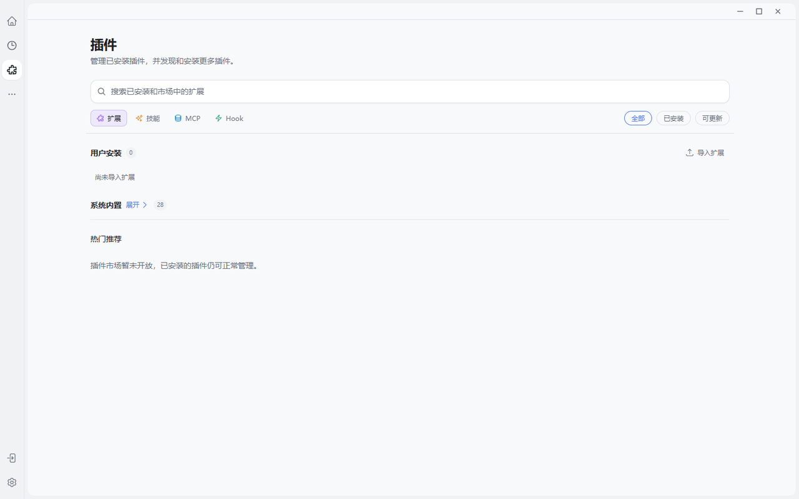

# Skills MCP 与插件让能力持续生长



> 模型决定思考上限，能力生态决定它能把多少事情真正做完。上图来自本次实际运行构建的插件中心，四类扩展不是概念名词，而是用户可以发现、管理和持续扩充的真实入口。

## 模型不是产品能力的全部

同一个模型，只有聊天能力时像一位知识顾问；获得工具、方法和受控运行环境以后，才像真正的工作伙伴。JustDo 用四类机制扩展 Agent：Skill 教它怎么做，MCP 给它外部工具，Extension 扩展 Gateway 运行能力，Hook 在事件发生时接入流程。

## 四类扩展各司其职

| 类型 | 它解决什么问题 | 谁拥有运行事实 |
| --- | --- | --- |
| Skill | 可复用步骤、规范和领域方法 | Gateway skills API |
| MCP | 外部数据、服务、工具和 MCP Apps | 原生 MCP 连接与工具调用 |
| Extension | 深入 Gateway 的运行时代码能力 | 原生 plugin inventory |
| Hook | 对运行事件作出反应 | 原生 hook runtime |

市场是分发入口，不是另一份运行态清单。当前市场 catalog 只开放 extension、skill、mcp，默认没有业务市场 provider。这个边界在 [插件系统架构](https://github.com/liangxhao/JustDo/blob/HEAD/docs/architecture/07-plugin-system.md) 中有明确说明。

## 八个内置 Skill 组成基础生产力

公开 manifest 默认启用八个 Skill：数据分析、图形设计、前端设计、DOCX、PDF、PPTX、Skill Creator 和 XLSX；同时额外声明 OpenClaw 的 coding-agent 与诊断类 custodian skill。当前清单见 [builtin-skills.json](https://github.com/liangxhao/JustDo/blob/HEAD/resources/builtin-skills.json)。

这组组合传达了一个很重要的产品方向：JustDo 的目标不是“回答更多问题”，而是把数据、图、网页、文档、演示和表格都变成可交付成果。

## MCP 正在从工具总线升级为 Agent 平台

2026-07-28 MCP 规范把远程核心改成无会话、可缓存、可路由的 HTTP 工作负载，并将长期任务放入 Tasks 扩展，同时强化 OAuth/OIDC 相关安全要求。参见 [MCP 2026-07-28 说明](https://blog.modelcontextprotocol.io/posts/2026-07-28/)。MCP Apps 又让工具可以携带跨宿主复用的交互界面。

JustDo 当前已经使用 MCP Apps 2.0 依赖并实现桌面宿主，但其本地产品架构仍需要关注两件事：

- 旧版 `@modelcontextprotocol/sdk` 与新 `@modelcontextprotocol/client` 并存时，要持续厘清各自用途和迁移范围。
- MCP 2026 的 stateless core、Tasks 和企业授权是协议能力，不能直接等同于 JustDo 已完成对应产品迁移。

## 插件安全来自安装和运行双重边界

JustDo 对压缩包路径穿越、绝对路径、符号链接、特殊文件和超大展开做检查；Extension 导入会审查 capability、operator grants、来源与 integrity，并用 review token 绑定同一内容。但 Extension 仍会进入 Gateway 的 Node 信任域，因此“通过审查”不等于“成为恶意代码沙箱”。

## 实操：让 Agent 自己核对能力目录

```text
请实际检查当前可用的 Skill 和工具目录，回答三个问题：
能否制作 PPTX、能否制作 XLSX、是否能通过工具搜索扩展能力。
必须依据当前目录事实，不要凭印象回答，也不要创建文件。
```

**实测结果：** Agent 调用了 `tool_search`、`tool_describe`、`skills_search` 和 `skills_read`。它确认 PPTX 与 XLSX Skill 均已安装，同时主动指出 PPTX 的生成依赖尚未在本轮验证；XLSX Skill 明确声明提供 Python 与 `openpyxl`；工具搜索只能发现已安装、已授权的能力，不能凭搜索结果自动安装插件或扩大权限。

这个结果比一句“支持 PPT、Excel”更可信：好的 Agent 不只列功能，还会区分“目录里有入口”“运行依赖已满足”和“本轮实际验证过”三个层次。

## 一条可复现的能力链

用同一任务连续展示三层能力：

1. Skill 指导 Agent 生成结构正确的 PPTX。
2. MCP 工具拉取业务数据。
3. MCP App 在会话中呈现可筛选图表，用户选择后再生成最终汇报材料。

由此可以看到，“知识、行动、界面、产物”不是四个产品，而是一条执行链。

## 结语

“模型决定上限，插件系统决定它每天能做什么。JustDo 用 Skill 沉淀方法，用 MCP 连接外部世界，用 Extension 增加深度能力，再用 MCP Apps 把工具结果变成界面。八个内置 Skill 已经覆盖数据、图、网页和办公产物。它的关键不是插件多，而是每一类插件都有清晰的运行权威、安装边界和审批路径。”
