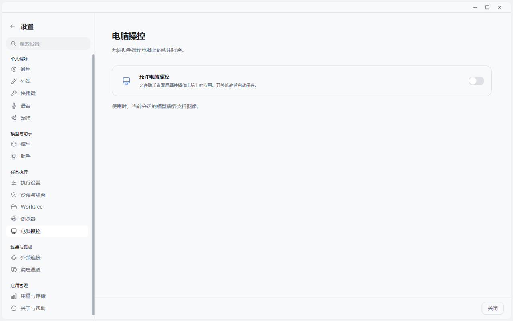
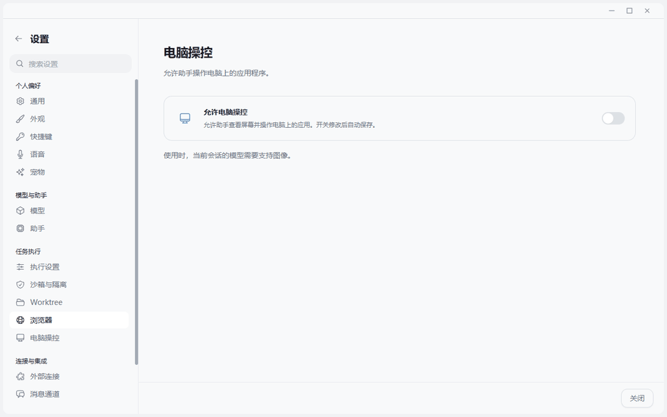

# 电脑操控让 Agent 跨越应用边界

> 网页之外，还有无数没有 API 的软件。电脑操控，是 Agent 迈进真实工作现场的最后一步。

## 从“会用网页”到“会操作电脑”

浏览器能力让 Agent 走进网页，电脑操控则让它面对那些更真实、更棘手的长尾现场：没有 API 的旧软件、只能通过窗口完成的设置、散落在多个应用之间的信息，以及必须亲手点一次才能复现的界面缺陷。这里不再是“调用一个接口”，而是看见、判断、行动，再把控制权稳稳交还给人。






JustDo 没有把这项能力藏进浏览器开关。`browser` 和 `computer` 是两种独立工具：前者围绕网页 Tab、DOM、AX、下载与浏览器身份；后者通过 Gateway 的电脑服务观察并操作本机图形界面。这个分离非常重要，因为“可以访问某个网页”不等于“可以控制整台电脑”。

## 当前源码已经实现什么

### 1. 默认关闭，必须显式启用

锁定的 OpenClaw Runtime 保留 `cua-computer` 扩展，但产品配置默认写入 `enabled: false`，全局 `computer` 工具也默认禁止。用户在“设置 → 电脑操控”打开开关时，Main 才通过带版本的原生配置补丁同时更新扩展状态和工具许可。

它不是 Renderer 里的一枚装饰性开关：启用前会读取真实工具策略，受限 profile、绝对白名单或通配符 deny 仍可阻止电脑操控，界面不能显示假成功。关闭时会写回明确的工具 deny，而不是只隐藏菜单。

### 2. 执行能力属于 Gateway，不属于页面脚本

原生 `computer` 工具通过 Gateway 电脑服务调用 CUA，负责截图、动作、引用校验、串行执行和运行结束清理。JustDo 沿用统一工具调用时间线，不额外增加鼠标键盘 IPC、截图缓存或第二套桌面自动化执行器。

这带来两个结果：

- 截图是模型观察，不会自动变成聊天附件或永久相册。
- 取消、连接代次、独占与幂等仍落在原生运行生命周期内，而不是由某个 React 组件猜测。

### 3. 用户可以看见电脑正在被操作

Windows 10 2004 及以上环境在真实前台动作发生时显示透明提示层：屏幕边缘高亮、大指针、光晕和点击反馈。提示层不抢焦点并默认排除在系统截图之外；需要远程观察时可以显式打开效果预览。

提示层只表达“电脑操作正在发生”，不冒充运行结果。租约到期只隐藏 UI，不宣称任务成功；后台窗口定向操作也不会伪装成物理鼠标移动。

### 4. 模型和运行环境都有准入条件

当前会话模型必须支持图像。Windows/Linux 使用锁定版本的本地 CUA Driver；Gateway 必须位于可访问的交互式桌面会话。沙箱任务不会因为用户打开了电脑操控开关就自动获得宿主桌面控制。

## 实操：先确认有没有权限，再谈自动操作

```text
请检查当前是否具备 computer 电脑操控工具。
不要启用权限，也不要点击或操作任何应用；
只报告工具是否可用、默认边界是什么，以及真正执行前需要用户做什么。
```

**实测结果：** Agent 调用了 `tool_search`，确认当前会话没有获得 `computer` 工具，只能看到浏览器等已授权能力；它没有尝试用浏览器或命令行冒充整机操控，也没有操作任何应用。这个“没有动作”的结果非常重要：JustDo 源码具备电脑操控入口，不代表每个会话天然拥有整机权限。真正执行前，用户仍需显式启用能力、允许工具进入会话，并在高风险动作前再次确认。

这也是最简单的安全验收方法：先问“你现在有什么权力”，再问“你能做什么”。如果 Agent 在权限缺失时仍声称已经点击桌面，就应该判定为失败。

## 六类适合验证的任务

### 桌面软件验收

> 打开这个 Windows 客户端，完成新建项目流程，记录每一步看到的状态；不要提交任何外部数据。

适合展示视觉理解、窗口切换、表单定位与结果复核。

### 复现只在 GUI 中出现的问题

> 把窗口缩放到 125%，打开设置页并复现按钮被遮挡的问题；只记录复现路径，不修改系统设置。

文件和日志无法证明的布局问题，需要真实界面观察。

### 跨应用整理信息

> 从会议记录中提取已确认事项，在项目管理客户端中准备对应更新，但提交前停下来让我确认。

这个场景能说明 Agent 可以跨窗口工作，也能说明“准备”和“代表用户提交”是两种风险级别。

### 无插件系统中的只读核验

> 打开库存客户端，查询这三个物料的可用数量并整理成表格；不要修改库存。

当软件没有 MCP、API 或 CLI 时，电脑操控是覆盖长尾系统的最后一公里。

### 视觉回归检查

> 依次打开三个页面状态，对照参考图检查间距、颜色和溢出；输出问题清单，不自动发布。

适合与代码修改、浏览器验证或截图证据组合。

### 人工接力

> 进行到登录、验证码或不可逆提交时暂停，说明当前页面和需要我完成的动作；我接管后再继续。

真正可信的 Computer Use 不是“永远自动”，而是知道什么时候把控制权还给人。

## 与 ChatGPT Computer Use 的能力对照

截至 2026-10-20，ChatGPT 官方将 Computer Use 定义为桌面应用中的独立能力：它可以在用户允许的 macOS 或 Windows 应用中点击、输入和导航；如果应用已经提供插件或 MCP，则优先使用结构化集成，视觉操作用于插件无法覆盖的界面。Windows 上它运行在活动桌面并占用前台，目标窗口必须保持可见。参见 [ChatGPT Computer Use 官方说明](https://learn.chatgpt.com/docs/computer-use) 与 [使用电脑完成任务](https://learn.chatgpt.com/use-cases/use-your-computer-with-codex)。

| 对比维度 | JustDo | ChatGPT Computer Use |
| --- | --- | --- |
| 产品入口 | “设置 → 电脑操控”显式总开关；会话通过 `computer` Tool 使用 | 桌面端安装 Computer Use 插件，以 `@Computer` 或具体应用启动 |
| 默认边界 | CUA 扩展默认关闭，工具策略默认 deny | 每个任务只可使用被允许的应用，可保存 Always allow 决策 |
| 与浏览器关系 | `computer` 与四模式 `browser` 工具严格分开 | `@Computer` 面向桌面应用，`@Chrome` 和内置 Browser 面向网页任务 |
| Windows 行为 | 需要可访问的交互式桌面会话；本机动作有透明边框和指针反馈 | 在活动桌面前台运行，会移动鼠标和键盘，不能在同一 Windows 会话后台工作 |
| 结构化能力优先级 | 浏览器、MCP、插件和电脑操控并列，由任务选择；沙箱不自动获得桌面权力 | 官方建议应用有插件或 MCP 时优先结构化集成，Computer Use 处理视觉长尾 |
| 可观察性 | 工具卡、运行状态与 Windows 提示层；截图不自动进入聊天历史 | 权限提示、前台操作过程与最终可审阅结果 |
| 模型要求 | 当前模型必须支持图像 | 困难视觉任务官方建议使用具备更强视觉判断的模型 |
| 管理粒度 | 当前重点是全局显式开关、原生工具策略和运行所有权 | 支持逐应用允许、Always allow 与管理员策略 |
| 平台差异 | Windows 有本机提示层；macOS 仍依赖上游驱动端点和系统权限 | macOS 可后台运行并可选择 Locked use；Windows 只能前台运行 |

这不是一张“谁赢了”的榜单。ChatGPT 的价值在于把逐应用授权、跨应用任务、前台占用和结构化工具优先原则做成了完整产品路径；JustDo 的特点是把能力接进 OpenClaw Gateway 的原生工具策略、会话运行事实和本地桌面提示层，并与自己的浏览器、沙箱、Worktree 和扩展系统组合。

## 值得借鉴的三个业界方向

### 从总开关继续走向逐应用授权

ChatGPT 会在任务中询问是否允许访问具体应用，并允许撤销持久许可。JustDo 当前的全局开关解决了“是否允许电脑操控”，下一步可以增加按应用、窗口或任务的许可范围。

### 结构化工具优先，视觉操作兜底

两者都不应把 Computer Use 当成所有任务的第一选择。能用 MCP、文件 API、浏览器 DOM 或应用插件完成时，结构化路径通常更稳定、可审计；只有无法通过这些路径验证时才切到截图、鼠标和键盘。

### Windows 前台占用必须被当成产品事实

ChatGPT 官方明确说明 Windows Computer Use 会接管活动桌面。JustDo 同样依赖交互式桌面会话，因此测试和生产使用都应避免在同一应用里并行运行两个操控任务，并允许用户快速停止、接管或转移到虚拟机。

## 安全边界必须说清楚

- 命令审批只约束 `exec`，不能自动视为每一次鼠标或键盘输入的审批。
- 页面、邮件和应用窗口里的文字都是不可信内容，不能因为界面要求就上传文件、泄露凭据或绕过限制。
- 发送消息、提交表单、购买、删除、覆盖或修改权限等动作，应在动作发生前让用户确认。
- 关闭提示层只改变可视反馈，不等于原生运行已经停止。
- 开启电脑操控不代表沙箱、远程节点或所有模型都获得同样能力。

## 安全的验证场景

准备一个不需要登录的桌面应用和一个可恢复的本地测试数据集：让 Agent 打开应用、读取三个字段、切换一个视图、把结果写入本地草稿，并在点击“保存”前暂停。验证时依次检查设置开关、工具调用、屏幕提示层、暂停点和最终复核。

不要用发送邮件、真实付款或删除文件作为测试案例。有效验证不追求动作最多，而是确保用户能清楚看到：Agent 在哪里操作、拥有什么权限、何时需要人、最终如何验证。

## 结语

“浏览器只能覆盖网页，真实工作还有大量没有 API 的桌面软件。JustDo 把电脑操控做成一项独立、默认关闭的原生工具能力：模型通过 Gateway 看截图、验证引用并串行动作，Windows 用边框和指针明确告诉你电脑正在被操作。对照 ChatGPT，行业已经形成一个共同方向——插件和结构化工具优先，视觉操作覆盖长尾，高风险动作交还给人。电脑操控的价值不是替人乱点，而是让 Agent 能跨过最后一道界面边界，同时仍然可见、可停、可接管。”
