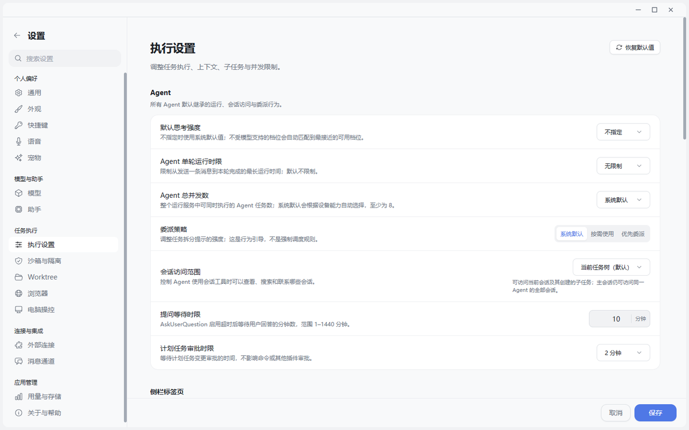
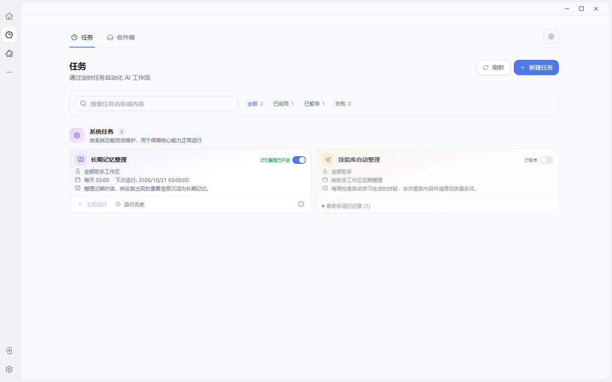
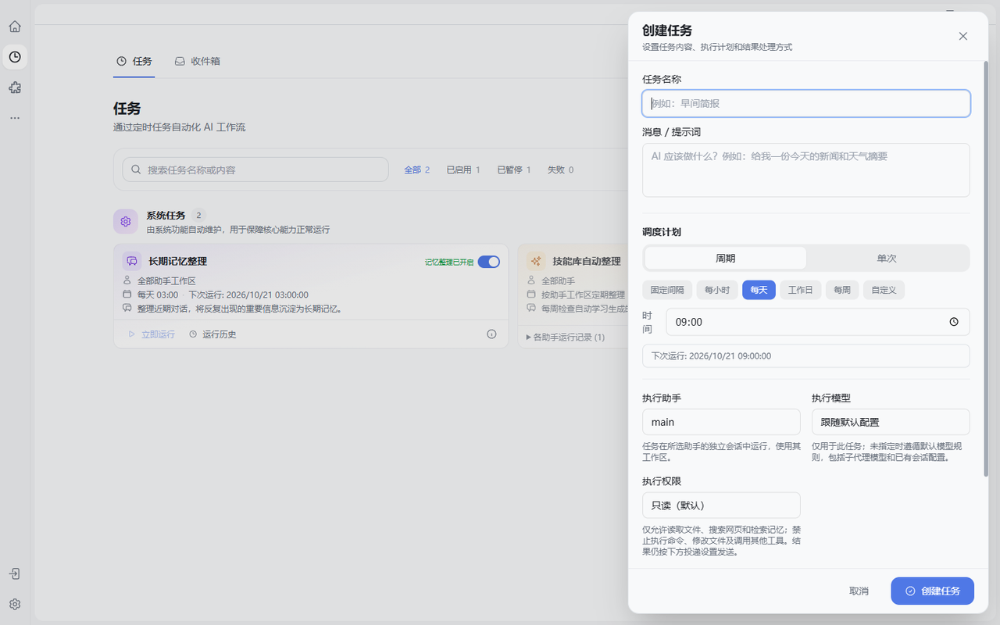
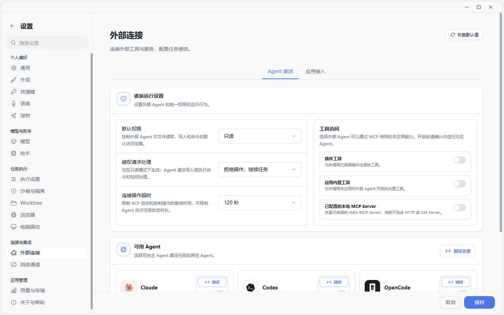
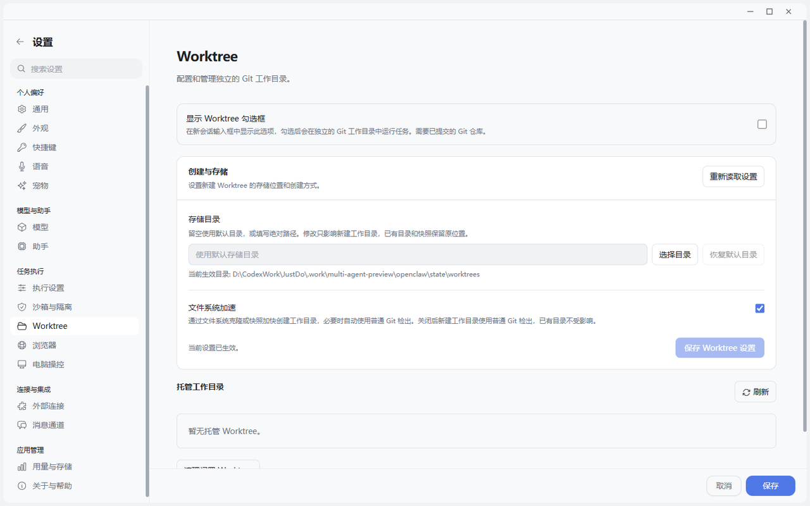

# Goal 定时任务与多 Agent 协作

## Agent 的价值在任务跨越一个回合以后才真正出现

一次问答可以解决“告诉我”。长期 Agent 要解决的是“替我推进”：任务可能持续几十分钟，等待用户输入，分给其他助手，每周重复执行，或者在应用重启后继续恢复。

JustDo 把这类能力拆成三条不同生命周期：Goal、定时任务和协作助手。它们不能混成一个万能的“后台运行”按钮。

## Goal 是持续推进的目标

Goal 拥有 active、paused、blocked、usage_limited、budget_limited、complete 六种原生状态。Main 只在同一 Goal 仍为 active 时协调下一回合，并考虑等待用户、审批、重试退避、续跑上限和显式停止。

关键设计是：一次模型回复结束，不代表整个目标结束。只有原生整轮 `executionSettled` 终态才能触发下一步判断。Goal ID fence 防止旧按钮修改已经替换的新目标。当前实现见 [Cowork Goal 生命周期](https://github.com/liangxhao/JustDo/blob/HEAD/docs/architecture/04-cowork-system.md)。

## 定时任务是原生调度加产品收件箱

Gateway cron 拥有 job 和 run；JustDo SQLite 只保存结果 receipt、已读状态、清理进度和 tombstone。暂停任务不会删除旧结果，删除结果也不会删除任务。

这种分工让定时任务同时满足两个要求：执行事实只有一份，用户又能在桌面应用里看到“有哪些新结果”。创建、手动运行、首次基线和中断追赶都有明确流程，参见 [定时任务架构](https://github.com/liangxhao/JustDo/blob/HEAD/docs/architecture/08-scheduled-tasks.md)。

## 多 Agent 有两种关系

Subagent 是树状任务关系，状态来自原生 session 投影；平级协作由默认关闭的 agent-team 扩展提供，成员之间通过原生 `sessions_send` 协作。一个 accepted 投递只表示消息被接受，不表示任务已经完成。

这一层次区分很重要：

- Subagent 像项目经理把一个子问题交给专门成员。
- 平级团队像几位专家围绕同一问题讨论和交叉检查。
- Swarm Workflow 则把协作过程投影成可观察的 DAG 和工作流界面。

## 与 A2A 的行业方向

Google 在 2026 年总结 A2A 的定位时强调：Agent 不是普通的无状态 API，它需要动态对话、安全交接和跨系统协作。参见 [How A2A is Building a World of Collaborative Agents](https://developers.googleblog.com/how-a2a-is-building-a-world-of-collaborative-agents/)。

JustDo 已经具备产品内多 Agent 会话、投递和协作 UI，但不能直接宣称已经实现 A2A 协议互操作。更准确的说法是：它已经验证了“协作 Agent 产品体验”，下一步可以评估用 A2A 暴露或接入跨厂商 Agent。

## 一个生动场景

用户提出：“为新产品发布准备完整方案。”主 Agent 创建一个 Goal，研究助手持续追踪竞品，数据助手整理指标，设计助手制作流程图和演示稿；每周一的定时任务刷新数据；当团队意见冲突时，用户进入群组讨论补充判断；所有结果最终回到主会话。

这不是同时开几个聊天窗口，而是有身份、有状态、有停止语义和结果回收的协作。

## 当前边界

平级 agent-team 默认关闭，且忙碌主会话上的可靠建群仍有生命周期整合限制。外部 A2A 互操作也不是当前源码已完成能力。必须把“产品内协作已实现”和“跨生态协议是下一步”分开。

## 结语

“真正的 Agent 不只完成一个回合，它要能把目标持续推进、把周期性工作自动重复、把不同问题交给不同助手。JustDo 用 Goal 管长期意图，用 Gateway cron 管时间，用原生 session 管子任务，再把结果、状态和停止入口投影到桌面。它已经具备多 Agent 产品体验，未来可以自然连接 A2A 这样的跨系统协作协议。”
