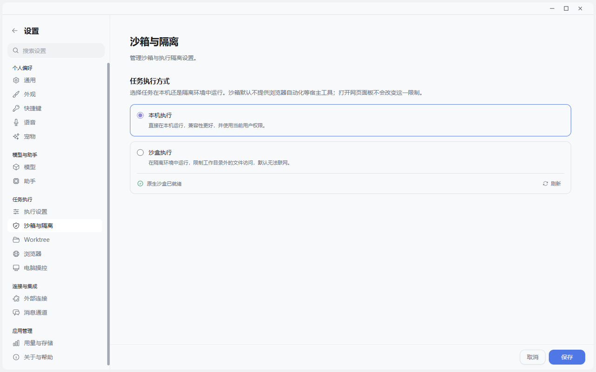

# 可信执行来自边界而不是口号

## 为什么 Agent 安全比聊天安全更难

聊天模型说错一句话，用户可以不采纳；Agent 点错一次按钮、覆盖一个文件或重复提交一次工单，后果已经发生。可信 Agent 的核心不是“提示词里写请谨慎”，而是系统能回答四个问题：谁在请求、它能访问什么、这次动作是否被批准、结果不确定时能不能安全重试。

实机界面没有把沙箱包装成一个模糊的“安全模式”，而是明确告诉用户：本机执行兼容性更好，沙盒限制工作目录外文件访问且默认不能联网，浏览器自动化等宿主工具也不会因为打开网页面板就自动获得。

## JustDo 的四层防线

### 1. Electron 进程边界

主窗口关闭 Node integration，开启 context isolation、sandbox 和 webSecurity；外部网页 guest 使用固定 preload、合法 partition、无 Node 权限和导航策略。普通网页不能继承主 Renderer 的 `window.electron`。

### 2. 最小 IPC

Main 把 Renderer payload 当成 unknown，校验类型、枚举、大小、路径、URL、调用来源和资源所有者。preload 暴露具体方法，而不是通用文件系统或任意 Gateway RPC。

### 3. 会话权限和审批

产品 ask/auto/full 映射为原生 guarded/workspace/full。权限切换不是只改 UI：下一回合发送前必须回读核对 session mode 和 root。Exec/plugin approval、跨会话可见性与 Windows MXC 沙箱是不同控制面，不能互相替代。

### 4. 文件、浏览器和插件的资源边界

文件预览不是通用 fs API；编辑 token 绑定 canonical path、owner、摘要与期限。浏览器上传只能来自真实任务工作区，下载和 PDF 拒绝覆盖并使用路径 reservation。插件包安装检查 traversal、symlink、特殊文件和 integrity。

完整边界与剩余风险见 [JustDo 安全模型](https://github.com/liangxhao/JustDo/blob/HEAD/docs/architecture/11-security-model.md)。

## Prompt Injection 为什么必须单独讲

网页内容、附件和工具结果都是不可信输入。OpenAI 的 Operator 安全说明把 prompt injection、模型失误和有害任务列为计算机操作的核心风险，参见 [Operator System Card](https://openai.com/index/operator-system-card/)。

对 JustDo 来说，正确原则是：网页可以提供事实，但不能授予权限；App 的 HTML 可以展示数据，但不能靠自己声明获得工具访问；关闭界面不能被解释为已经取消后台副作用；传输超时不能自动重放可能已经被接收的写操作。

## MXC 沙箱的正确说法

最新版依赖包含 Windows 的 `@openclaw/mxc-sandbox`，安全架构也将 MXC 描述为工具子进程可见文件和网络的控制面。它能缩小部分命令执行的暴露面，但不能隔离 Main、模型 API、浏览器或高权限 Gateway Extension。因此应说“提供可选的工具子进程沙箱”，不要说“整个 Agent 都在绝对沙箱里”。

## 一组可复现的安全验证

设计一次需要确认的动作：让 Agent 准备修改文件，但在最终写入前触发审批；再切换权限模式，检查下一回合是否完成回读核对。浏览器部分可以验证用户标注时 Agent 被 lease 阻止操作。安全验证的重点是“系统明确拒绝了什么”，而不只是一个漂亮的确认弹窗。

## 当前剩余风险

- `connect-src` 仍包含通配，CSP 不是网络白名单。
- `localfile://` 和 `localmedia://` 本身没有 allow-root/token，安全依赖上层可信准入。
- Node Extension 进入 Gateway 信任域，安装可信代码仍是重要决定。
- MCP App 关闭不证明后台操作取消，未知结果不能自动重试。

公开这些边界不会削弱产品，反而能证明团队理解 Agent 的真实风险模型。

## 结语

“JustDo 的安全不是一个总开关，而是一组互不替代的边界：网页没有 Node 权限，Renderer 没有通用文件系统，单次审批不能变成全局授权，浏览器文件只能落在允许的工作区，插件安装也不等于恶意代码沙箱。更重要的是，系统把‘结果未知’当作一种真实状态，不会为了看起来顺畅就自动重复可能已经执行的动作。”
