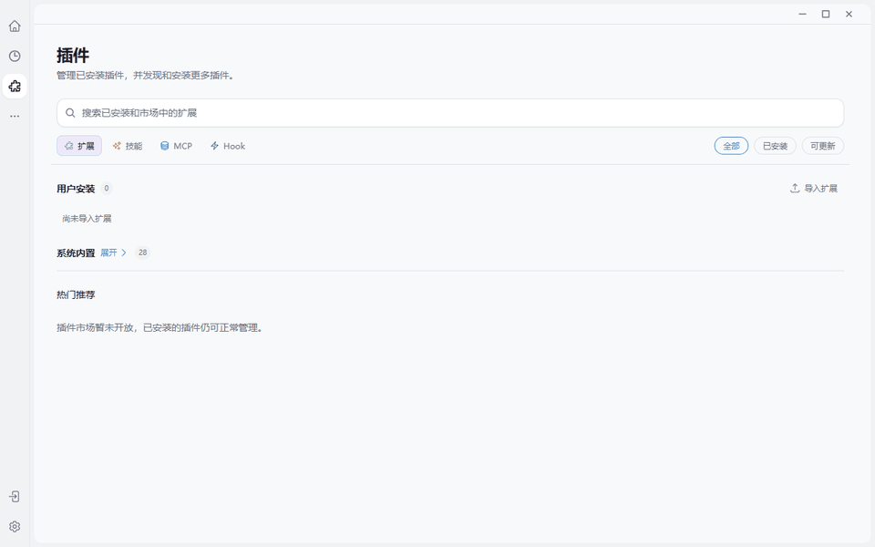

# 对照 2026 Agent 技术浪潮

> 行业趋势最终必须落进产品现场：长期会话、生成式 UI、MCP、浏览器和多 Agent 如果仍是五个孤岛，就还称不上真正的 Agent 平台。

## 结论

JustDo 的主要技术方向与 2026 年行业演进高度一致：会话从请求响应走向长期事件流，工具接入从私有函数调用走向 MCP，工具结果从结构化数据走向 MCP Apps，浏览器从脚本自动化走向结构与视觉混合操作，多 Agent 从内部编排走向 A2A 互操作。

真正值得做的不是继续堆功能，而是把已经出现的能力收敛成稳定、可观测、可升级的产品协议。

## 1. 从工具调用到 Agent 运行平台

MCP 2026-07-28 取消协议级 session，新增 stateless core、显式状态 handle、可缓存列表、Tasks 扩展和更严格的授权要求。对 JustDo 的意义是：

- 外部 MCP 服务可以更容易水平扩展。
- 长任务应逐步对齐 Tasks，而不是靠私有轮询模拟。
- 桌面 OAuth 客户端、issuer 绑定和企业授权应成为升级重点。
- 观测与路由可以利用标准 header 和 trace context。

建议：建立 MCP v2 迁移矩阵，逐项列出 transport、Tasks、Apps、authorization 和旧 SDK 兼容，而不是一次性替换全部调用面。

## 2. 从文字回答到开放的生成式 UI

MCP Apps 已在 ChatGPT、Claude、VS Code 等宿主落地，工具开发者可以一次构建，在多个兼容客户端中呈现界面。JustDo 已实现 AppBridge 宿主、draw.io 和文件入口，是当前最接近行业前沿的能力之一。

建议：下一阶段重点不应是再造更多私有 widget 类型，而是完善 MCP Apps 的宿主能力矩阵、生命周期观测、无障碍、离线资源和发布验收；私有交互式回答保留为即时生成的轻量通道。

## 3. 从 DOM 自动化到混合 Computer Use

行业正在形成三层浏览器操作：API/MCP 工具最可靠，DOM/AX refs 最高效，截图与视觉动作覆盖长尾。OpenAI CUA 强调通用截图—推理—动作循环；agent-browser 强调 accessibility snapshot 和 refs；Playwright 则用可操作性检查与 auto-wait 降低脚本脆弱性。

建议：把 JustDo 的 browser policy 明确成结构优先、视觉兜底、危险动作审批，并记录每次动作使用了哪类感知证据。对复杂 Canvas 和跨域内容再引入视觉定位，不让截图成为默认高成本路径。

## 4. 从子任务到跨系统 Agent 协作

A2A 的价值不是“再造一个工具协议”，而是让独立 Agent 公开能力、持续对话、交接任务和返回可验证状态。JustDo 已有产品内 Subagent、agent-team 和 Swarm Workflow，为跨系统协作准备了用户体验基础。

建议：先定义 JustDo Agent Card、任务状态映射、身份和授权模型，再评估 A2A 接入。不要把 `sessions_send` 简单包装成 A2A；跨组织 Agent 需要更强的身份、审计和数据边界。

## 5. 从即时助手到 always-on 工作伙伴

2026 年新一代工作 Agent 强调独立计算机、浏览器、连接的应用、长期目标和主动工作。OpenAI 的 Dots 与 ChatGPT Work 都把“持续在场、跨应用执行、形成交付物”作为核心产品叙事。参见 [Introducing dots](https://openai.com/index/introducing-dots/) 和 [ChatGPT Work](https://openai.com/index/chatgpt-for-your-most-ambitious-work/)。

JustDo 的 Goal、cron、结果收件箱和桌面本地工作区与这条趋势吻合。下一步差异化应落在本地控制、可审计状态和插件生态，而不是只模仿云端 Agent 的功能列表。

## 建议路线图

| 优先级 | 建议 | 价值 |
| --- | --- | --- |
| P0 | 建立当前 `v2026.10.20` 完整可复现源码快照与能力测试矩阵 | 避免文档和实现快速漂移 |
| P0 | 为浏览器、MCP Apps、Goal 和协作统一操作审计视图 | 让用户知道做了什么、凭什么、是否完成 |
| P1 | MCP 2026 / SDK v2 分阶段迁移 | 获得 Tasks、授权与规模化部署能力 |
| P1 | 浏览器混合感知策略与动作证据记录 | 提升成功率并降低 token/延迟 |
| P1 | MCP Apps 生命周期、无障碍和离线发布验收 | 把领先能力变成稳定产品能力 |
| P2 | A2A Agent Card 与跨系统任务试点 | 从产品内协作走向生态协作 |
| P2 | 评测体系覆盖会话恢复、浏览器成功率和高风险拒绝 | 用可复现结果替代主观印象 |

## 不建议追逐的伪前沿

- 不为“更自主”取消审批和人工接管。
- 不把所有网页任务都交给视觉模型。
- 不用多 Agent 数量代替清晰的任务分工。
- 不把 MCP 接入数量当成可用性指标。
- 不把一个炫目的生成式界面当成已经完成业务闭环。

## 结语

“2026 年 Agent 技术正在收敛成几条主线：MCP 管工具和应用，Computer Use 管没有 API 的界面，A2A 管 Agent 之间的协作，长期 session 和 Tasks 管持续工作。JustDo 已经站在这些交叉点上。接下来最重要的不是再加十个按钮，而是把协议升级、可观测性、浏览器混合感知和跨 Agent 身份做扎实。”
