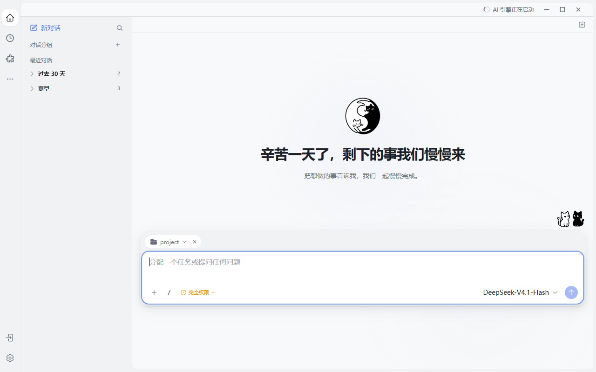

# 从目标到交付：一条完整的 JustDo Agent 工作流

> **先记住一句话：** 一条完整 Agent 工作流，必须把目标、证据、人的决定和最终交付串成同一条线。

如果 AI 给你的永远只是一段文字，那么真正的工作仍然留给了你。JustDo 的差异不在于按钮更多，而在于它能把会话、网页、生成式界面、桌面应用、文件和人的决定组织成同一条可恢复执行链。



下面以一个真实工作目标为例，看看这些能力如何协同：

> 调研三家 Agent 产品最新的浏览器与电脑操控能力，保留来源，生成一张可筛选对比表，再给出一页管理层结论。

这条任务足够典型：它需要理解目标、检索最新资料、判断来源质量、处理歧义、组织复杂信息，并交付可继续编辑的成果。单纯聊天可以回答其中一部分；完整 Agent 工作流则要把每一步接起来。

## 1. 先把目标变成可执行约束

Agent 首先识别任务中的开放问题：比较哪些产品、重点关注哪些平台、结论服务技术评审还是管理层决策。它不应该暗自猜测重要约束，而应通过 Ask User 给出结构化选项。

一个有效的确认问题可以包含推荐项、单选、多选和“其他”输入。例如：

- 报告更偏向技术选型，还是业务决策？
- 是否把登录、验证码、高风险动作确认纳入比较？
- 只研究浏览器，还是同时覆盖整机电脑操控？

用户提交后，答案进入同一条会话执行链；关闭弹窗并不等于已经回答，断线重连也能根据稳定问题身份恢复等待状态。这种设计把“人在回路”从一句口号变成可追踪协议。

## 2. 会话不是打字机，而是执行时间线

任务开始后，准备上下文、模型思考、工具调用、等待确认、组织内容和最终结算沿着同一条时间线展开。用户可以在输出过程中阅读前文、查看工具卡片或排队补充要求，而不必等一堵文字墙一次性落下。

真正的流畅来自三件事：

1. 增量事件让过程持续可见；
2. Gateway 的权威历史负责最终对账；
3. 稳定的会话、运行和问题身份支持重连恢复。

因此，Stop 的确认不等于整轮已经结算，界面的临时状态也不能覆盖后端事实。用户看到的是顺滑体验，背后依靠的却是严格状态模型。

## 3. 浏览器成为共同工作现场

Agent 需要访问产品文档、版本说明和公开测试资料。JustDo 可以在右侧打开真实网页，读取 DOM、可访问性树、正文和截图，并执行点击、填写、下载或标签页切换。

这里最重要的不是“会点网页”，而是过程透明：用户知道 Agent 正在哪个页面、依据什么证据行动，并能在登录、验证码或关键选择出现时接管。内置浏览器、隔离环境、用户 Chrome 和扩展模式分别服务不同身份与风险场景，不必共享一套模糊授权。

结构化页面信息负责速度，截图负责视觉校验，控制租约负责协调人和 Agent 谁握着方向盘。浏览器由此从隐藏工具升级为共同工作区。

## 4. 电脑操控覆盖没有 API 的长尾

有些证据或交付步骤位于桌面软件中，没有稳定 API，也不适合强行塞进浏览器自动化。JustDo 将原生 `computer` Tool 作为独立能力，并且默认关闭；拥有浏览器权限，不代表可以顺带控制整台电脑。

启用后，Agent 可以观察屏幕、打开应用、切换视图并准备本地保存。Windows 上的屏幕边框、指针和点击反馈让操作发生在可见现场。保存、发送、付款和删除等动作仍应在执行前重新确认。

这与 2026 年业界的 Computer Use 路线形成一致分工：优先使用插件、MCP 或明确 API 处理稳定链路，再用视觉操控覆盖长尾界面。视觉控制扩大了能力边界，也带来了前台占用、误点、提示注入和高风险动作治理等真实约束。

## 5. AI for UI 把复杂答案变成决策界面

完成资料收集后，模型不必把所有结果继续压进聊天气泡。比较任务适合可搜索、可筛选的表格；趋势适合图表；参数收集适合表单；系统关系适合流程图。

在这条工作流中，Agent 可以生成产品对比组件，让用户筛选平台、风险和接管方式；用户选择某个方案后，界面先把操作转成可读建议，加入草稿并发送，再由 Agent 根据真实选择继续推理。交互界面降低认知负担，却不会绕过工具权限或代替用户发送。

随后，结论还可以进入 draw.io，转成一张可编辑的能力边界图。对话没有消失，但它不再是唯一界面。

## 6. Skills、MCP 和插件把结论变成交付物

研究结果最终要离开聊天窗口。JustDo 的内置 Skills 覆盖数据分析、图表、前端、DOCX、PDF、PPTX 和 XLSX；MCP 连接外部服务和交互应用；插件为特定场景提供更深能力。

在本例中，可以同时生成：

- 一张包含来源链接、更新时间和能力标签的 XLSX 对比表；
- 一页面向管理层的结论摘要；
- 一张解释浏览器、电脑操控与人工接管边界的流程图。

“知识、行动、界面、产物”不是四套孤立产品，而是一条从证据到交付的连续链路。

## 7. 一次任务可以成长为长期目标

Agent 产品变化很快，一次调研会迅速过期。用户可以把工作升级为 Goal，再配置每周定时任务，持续检查产品更新并把新结果送入收件箱。可以并行拆解的子问题交给协作 Agent，但 `accepted` 只表示已接收，不等于已经完成。

这种状态区分非常关键：一次回复结束不代表目标结束，桌面关闭也不应该抹掉运行事实。`active`、`blocked`、`limited`、`complete` 等状态让长期工作能够被追踪，而不是在聊天记录里失去下文。

## 8. 可信来自边界，而不是“全自动”

这条链路越长，越需要明确控制面：

| 环节 | 可见性 | 人的控制点 |
| --- | --- | --- |
| 会话执行 | 状态、工具卡片、增量内容 | 停止、追加要求、恢复后核对 |
| Ask User | 问题身份、选项、等待状态 | 选择、补充、取消 |
| 浏览器 | 页面、标签、来源、控制租约 | 登录、验证码、接管与归还 |
| 电脑操控 | 独立开关、前台动作反馈 | 启用、暂停、高风险动作确认 |
| AI for UI | 结构化组件与用户选择 | 加入草稿后主动发送 |
| 长期任务 | Goal、定时运行和结果状态 | 暂停、恢复、调整范围 |

JustDo 的目标不是把人赶出工作流，而是把机械步骤接过去，把关键判断留给人。能力来自行动，可信来自边界。

## 可直接复用的任务模板

```text
调研三家主流 Agent 产品最新的浏览器与电脑操控能力。

要求：
1. 优先使用官方文档和发布说明，保留来源与发布日期；
2. 对比浏览器模式、整机控制、人工接管、高风险确认和平台限制；
3. 信息不足或比较口径有歧义时，先用结构化问题询问我；
4. 生成一张可搜索、可筛选的对比表；
5. 输出一页管理层摘要，并明确区分事实、推断和建议；
6. 所有外部发送、保存覆盖或账号操作必须在执行前确认。
```

## 一次更小、但真正跑通的完整实操

为了避免把“复杂计划”误写成“已经完成”，本次还运行了一条可在十秒内核验的只读工作流：

```text
请完成一个小型只读工作流：先列出当前目录顶层条目，再读取 README.md；
如果 README.md 不存在就读取 AGENTS.md。
最后输出一张三列表格：证据、你的判断、下一步建议。
不得修改或创建文件。
```

**实测结果：** Agent 先调用 `ls`，发现 `README.md` 不存在；随后按后备规则调用 `read` 读取 `AGENTS.md`，最后输出“证据—判断—建议”表格，并明确没有写入文件。整个过程用时约 8 秒。这条小任务同时验证了工具调用、条件分支、证据引用、结构化输出和安全边界，足以证明“执行链”不是一张概念图。

## 结语

从一句话到一份拿得走的成果，中间每一步都应该看得见、叫得停、接得住。JustDo 不是替用户拥有电脑，而是在用户允许的边界里，把工作持续向前推进。
