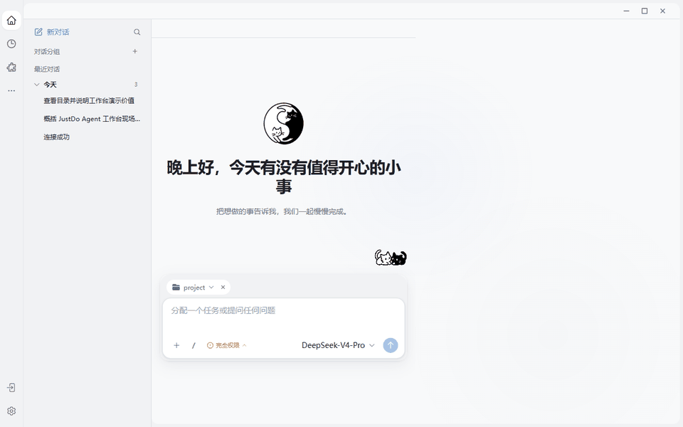

# JustDo Agent：从流畅会话到真实行动

## 不是多一个聊天框，而是多一个能把工作推到终点的搭档

你说一句目标，它开始行动：在会话里理解意图，在网页中寻找事实，把复杂信息变成能点、能选、能编辑的界面；遇到必须由人决定的岔路就停下来问，得到答案后继续向前，直到交付物真正落地。

> **一句话定位：** 普通 AI 把答案交给你，JustDo 把工作接过去——过程看得见，关键处叫得停，结果拿得走。

这是一套基于最新公开源码、实际运行验证和 2026 年 Agent 技术进展写成的系列文章。每一个判断都有源码或公开资料依据，每一个关键画面都来自真实运行；封面负责建立想象，实机截图和动图负责证明能力。

> 截图说明：以上画面来自 2026-10-20 实际下载并启动的最新源码，不是产品效果图。截图使用独立测试数据目录，没有展示用户真实会话或凭据。全部静态截图已在 DeepSeek 模型配置、Gateway 状态库初始化和真实工具调用验证完成后重新拍摄，不再保留启动初期的引擎告警。

## 先看 30 秒：让 Agent 真正跑起来

别急着看功能清单，先看一项工作怎样“活”起来。下面四段不是概念动画，而是本次实际运行构建的实机录制：从一句指令开始，状态亮起、工具介入、答案生长；随后镜头掠过工作台、AI for UI、浏览器与电脑操控边界。为了适合网页和 Markdown 阅读，录屏做了压缩，所有凭据均保持遮蔽；电脑操控仅展示入口，没有开启权限。

**第一幕：它不是在“憋答案”，而是在工作。** 思考、工具调用、流式正文和最终结算依次出现，一次 Agent 回合从黑盒变成可见过程。

**第二幕：能力不是散落的按钮。** 模型、插件、定时任务和浏览器汇入同一张桌面工作台，临时对话可以自然升级为长期任务。

**第三幕：答案开始拥有界面。** 浏览器带回现场，MCP Apps 把结果变成可以操作的应用，执行设置为每一次行动划清边界。

**第四幕：能力越强，边界越要清楚。** 网页操作与整机操控不是同一份授权；什么时候只能看网页，什么时候允许跨应用行动，用户一眼就能看懂。

## 为什么值得关注

过去，我们把问题交给 AI，然后自己接手剩下的工作。现在，把目标交给 JustDo：它会对话，但不停在对话；它会浏览，却不是躲在后台乱点；它会生成界面，让复杂选择变得可以操作；它还能跨越桌面应用、组织长期任务。更重要的是，你始终看得见它在做什么，随时可以暂停、确认和接管。这不是一个更会说话的模型，而是一个真正进入工作现场的 Agent。

## 五个让人记住 JustDo 的瞬间

### 1. 你还在阅读，它已经开始行动

发出任务后，JustDo 不会用一个旋转图标把所有过程藏起来。准备上下文、模型思考、调用工具、等待确认、组织答案，每个阶段都沿着同一条会话时间线展开。你可以继续阅读、追加要求、切走再回来；断线重连后，真实历史会重新接管画面。

**流畅不只是字出现得快，而是任务再复杂，人的注意力也不会被界面打断。**

### 2. 答案不再是一堵文字墙

需要比较时，答案变成能搜索和排序的表格；需要看趋势时，它变成可以切换系列的图表；需要收集条件时，它主动生成表单；需要画清关系时，draw.io 直接出现在工作现场。

这就是 AI for UI：模型不只决定“说什么”，还会判断“用什么界面，能让人更快做出决定”。用户的操作先形成可读建议，确认加入草稿并发送以后，Agent 才继续执行。界面变得主动，控制权仍然属于人。

### 3. 浏览器第一次变成透明的共同工作区

你说“去网上查清楚”，右侧真实网页随即打开。Agent 可以读取 DOM、可访问性树、页面文字和截图，也可以点击、填写、下载和切换标签页。你看得见它在哪里、依据什么行动；遇到登录、验证码或关键选择，可以立刻接管方向盘。

JustDo 同时支持内置浏览器、隔离环境、用户 Chrome 和浏览器扩展四种模式。不同网页、不同身份、不同风险，不必挤进同一种授权。

### 4. 网页之外，它还能跨过应用边界

大量真实工作仍然藏在没有 API 的桌面软件里。JustDo 把电脑操控做成独立、默认关闭的能力：它可以观察屏幕并操作应用，但不能因为拥有浏览器权限就顺带控制整台电脑。

这项能力最动人的地方不是“AI 会点击”，而是每一次点击都发生在可见现场：用户知道它何时接管，能够随时暂停，并在保存、提交等关键动作前重新握住控制权。

### 5. 一次对话可以成长为持续完成的目标

今天没有做完的任务，可以成为 Goal；下周还要重复的工作，可以交给定时任务；能够并行拆解的部分，可以交给其他助手。一次回复结束，不再意味着工作的上下文随之消失。

JustDo 记录的不只是聊天记录，还有任务是否活跃、是否受阻、是否受限、是否真正完成。**Agent 的价值从“这一轮说得多好”，转向“这件事到底有没有向前推进”。**

## 它和普通聊天助手，差在哪里

| 普通聊天助手 | JustDo Agent 工作台 |
| --- | --- |
| 给出一段答案，剩下的步骤交还给用户 | 接住目标，继续调用工具、浏览网页并生成交付物 |
| 复杂信息继续堆进聊天气泡 | 根据任务生成表格、图表、表单、流程和画布 |
| 网页操作隐藏在后台，过程难以接管 | 页面与会话并排，人和 Agent 共享同一个工作现场 |
| 浏览器权限与整机操作容易混为一谈 | `browser` 与 `computer` 独立授权、独立治理 |
| 关闭窗口或断线后，运行状态容易模糊 | 依据 Gateway 权威历史和真实 run 状态恢复与对账 |
| 一次回复就是一次任务的终点 | Goal、定时任务和协作助手让工作可以持续推进 |

## 真正吸引人的，不是“全自动”

JustDo 并不试图把人赶出工作流。相反，它会在真正需要人的地方停下来：目标有歧义时用 Ask User 给出结构化选项；网页需要登录时邀请接管；工具涉及风险时等待审批；电脑操控默认关闭；生成式界面的操作也不会绕过原有工具权限。

> 最好的 Agent 不是一声不响地替你决定一切，而是把机械步骤接过去，把关键判断留给你。

## 一句话定位

JustDo 当前最有辨识度的产品结构，可以概括为一句话：

> 一个以本地桌面为工作现场、以 OpenClaw Gateway 为执行内核、同时拥有对话界面、生成式 UI、真实浏览器和长期任务能力的个人 Agent 工作台。

截至 2026-10-20，本次核验源码的应用版本为 `v2026.10.20`，锁定 OpenClaw `v2026.10.4`。源码已经包含图文与本地流式媒体、细粒度会话状态、可恢复 Ask User、MCP Apps 2.0、内置浏览器工作区、排队输入、Goal、定时任务、平级助手协作与 Windows MXC 沙箱等能力入口。版本事实以 [package.json](https://github.com/liangxhao/JustDo/blob/HEAD/package.json) 为准。

## 系列目录

1. [从聊天助手到行动工作台](01-从聊天助手到行动工作台.md)
2. [流畅会话不是打字机效果：图文、Media、状态与 Ask User](02-流畅会话不是打字机效果.md)
3. [AI for UI 让答案变成可操作界面](03-AI-for-UI让答案变成可操作界面.md)
4. [浏览器从工具升级为共同工作现场](04-浏览器从工具升级为共同工作现场.md)
5. [电脑操控让 Agent 跨越应用边界](05-电脑操控让Agent跨越应用边界.md)
6. [Skills MCP 与插件让能力持续生长](05-Skills-MCP与插件让能力持续生长.md)
7. [Goal 定时任务与多 Agent 协作](06-Goal定时任务与多Agent协作.md)
8. [可信执行来自边界而不是口号](07-可信执行来自边界而不是口号.md)
9. [对照 2026 Agent 技术浪潮](08-对照2026-Agent技术浪潮.md)
10. [从目标到交付：一条完整的 JustDo 工作流](09-从目标到交付的完整工作流.md)
11. [资料与源码证据](资料与源码证据.md)

## 推荐阅读路径

如果你关注产品价值，可以按 1 → 2 → 3 → 4 → 5 → 7 → 8 阅读，重点理解“从一句话到完成工作”。如果你关注工程实现，可以按 1 → 2 → 6 → 4 → 5 → 8 → 9 阅读，重点考察权威数据、稳定身份、恢复机制和权限边界。想快速理解各项能力如何串成一条执行链，可以直接阅读第 10 篇。

## 证据口径

- “已实现”表示在 2026-10-20 核验的公开源码或当前架构文档中能找到明确入口、数据流或测试约束。
- “有限实现”表示主链路已存在，但仍有平台、生命周期或交互限制。
- “建议演进”是结合 2026 年行业标准做出的产品建议，不描述为现状。
- 9 月本机源码快照只用于交叉验证基础架构；凡与本次核验源码不同，均以后者为准。
